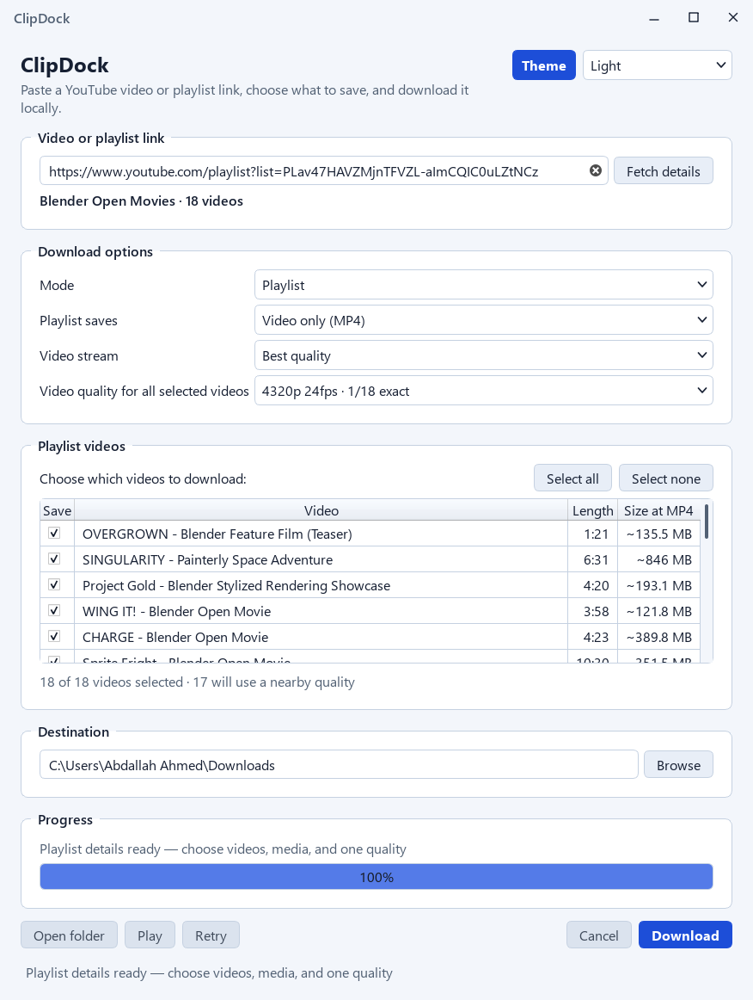

# ClipDock

<p align="center">
  <a href="https://github.com/Abdalllah10Ahmed/ClipDock/actions/workflows/ci.yml"></a>
  <a href="https://github.com/Abdalllah10Ahmed/ClipDock/releases"></a>
  <a href="https://github.com/Abdalllah10Ahmed/ClipDock/releases/latest"></a>
  <a href="LICENSE"></a>
  
</p>

Windows desktop app to download video, audio, thumbnails, and manual captions from popular sites (best-effort, powered by [yt-dlp](https://github.com/yt-dlp/yt-dlp)).

## Table of contents

- [Overview](#overview)
- [Features](#features)
- [Screenshots](#screenshots)
- [Install](#install)
- [Quick start](#quick-start)
- [Captions & availability](#captions--availability)
- [Requirements](#requirements)
- [Run from source](#run-from-source)
- [Build](#build)
- [Disclaimer](#disclaimer)
- [License & third-party notices](#license--third-party-notices)

## Overview

ClipDock is a Windows 10/11 app for saving publicly accessible media from popular yt-dlp-supported sites. It supports video (MP4), audio (MP3), thumbnails, and author-provided/manual captions (SRT/VTT), plus playlists/collections and mixed-site batch queues where supported. Available formats and options depend on the site and link.

## Features

- **Multi-site (best-effort):** Download from popular yt-dlp-supported sites; available formats and options vary by site/link.
- **Formats:** Video (MP4), audio (MP3), thumbnails, and author-provided/manual captions (SRT/VTT).
- **Playlists & batch queue:** Supported playlists/collections and mixed-site queues with per-item progress and results.
- **Quality options:** Choose available video/audio quality, bitrate, and caption language/format when provided.
- **Clean variants:** Prefers a no-watermark variant when exposed by the source (no watermark removal claimed or guaranteed).
- **Convenience:** Drag-and-drop links, remembers window size/position and last download folder, and keeps history with retry/resume where applicable.
- **Windows-friendly:** Per-user installer (no admin rights) and optional on-demand FFmpeg download only when needed, with your consent.
- **Themes & updates:** Light/dark themes, optional automatic update checks, and in-app update assistance.

## Screenshots


<details>
<summary>More screenshots</summary>

**Playlist mode**



**Dark theme (Nord)**


**First-run FFmpeg prompt**

<p align="center">
  
</p>

</details>

## Install

1. Download **`ClipDock-Setup.exe`** from the [Releases](https://github.com/Abdalllah10Ahmed/ClipDock/releases/latest) page.
2. Run the installer (per-user, no administrator rights required).

**Notes**
- The installer is not code-signed, so Windows SmartScreen may warn you. Click **More info → Run anyway** if you trust the source.
- On first run, ClipDock checks for FFmpeg. If it is missing, it may offer a one-time download/install (needed for merging, conversion, and some MP3 features). You can decline and still use features that do not require it.

## Quick start

1. Paste a supported URL (or a playlist/collection URL in **Playlist** mode, or multiple links in **Batch queue**).
2. Click **Fetch details** (single/playlist modes).
3. Choose a mode: **Video (MP4)**, **Audio (MP3)**, **Thumbnail**, **Subtitles**, **Playlist**, or **Batch queue**.
4. Pick available quality/format/bitrate/language options (options depend on the site and link).
5. Choose an output folder and click **Download**.

## Captions & availability

- **Manual captions only:** ClipDock supports author-provided/manual captions (SRT/VTT). Auto-generated captions are not included.
- **Availability varies:** Caption tracks, languages, formats, and media quality depend on the source site/link and extractor support.
- **Not all links work:** Private, removed, age/region-restricted, DRM-protected, or otherwise unavailable items may fail. In playlists/batches, failures are reported per item where possible.

## Requirements

- Windows 10/11 (x64)
- Internet access for supported sites
- Python 3.10–3.14 (only needed when running from source)

Runtime dependencies are PySide6 and yt-dlp (bundled in releases). FFmpeg is used for media processing and may be downloaded on demand when needed.

## Run from source

```powershell
git clone https://github.com/Abdalllah10Ahmed/ClipDock.git
cd ClipDock
.\scripts\setup.ps1
.\scripts\run.ps1
```

`setup.ps1` creates `.venv`, installs pinned Python packages, and fetches/verifies bundled binaries.

## Build

```powershell
# Windows executable (dist\ClipDock\)
.\scripts\build_exe.ps1

# Installer (dist\ClipDock-Setup.exe)
.\scripts\build_installer.ps1
```

See `scripts/` for additional build options and [dev/CHANGELOG.md](dev/CHANGELOG.md) for release notes.

## Disclaimer

Only download content you own or are authorized to download. You are responsible for complying with applicable laws and the terms of the sites you use. ClipDock does not bypass private, age, region, DRM, or verification controls.

## License & third-party notices

- ClipDock source: [LICENSE](LICENSE)
- Third-party components: [dev/THIRD_PARTY_NOTICES.md](dev/THIRD_PARTY_NOTICES.md)
