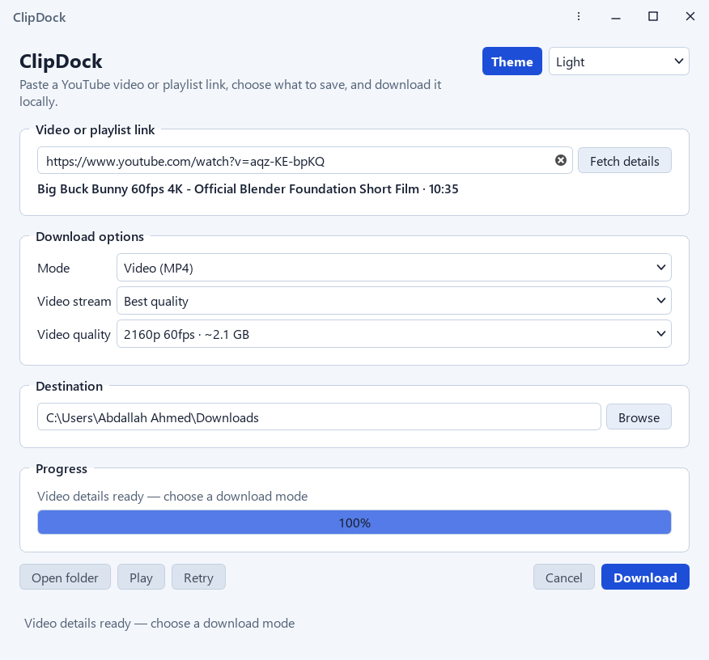
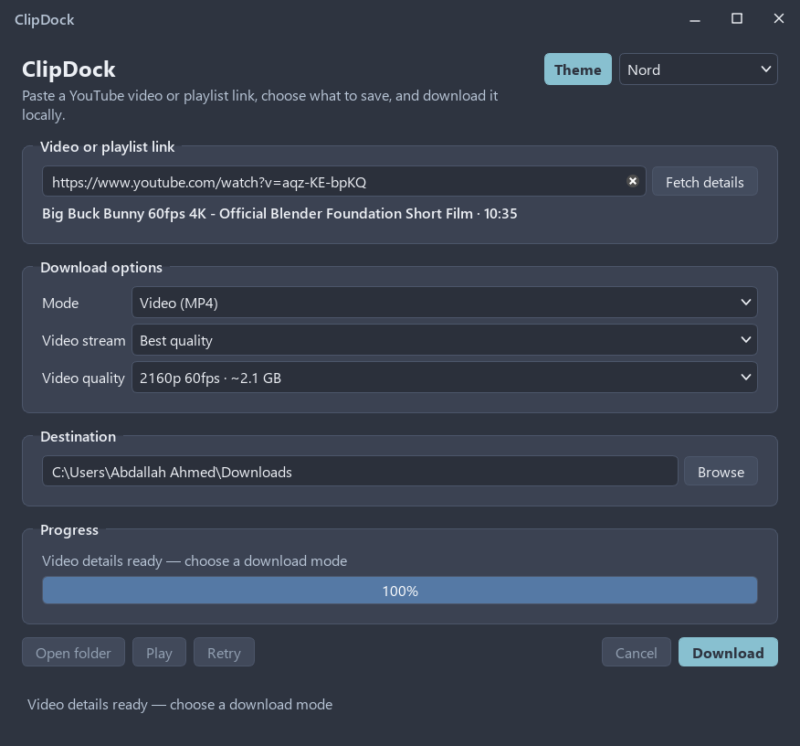
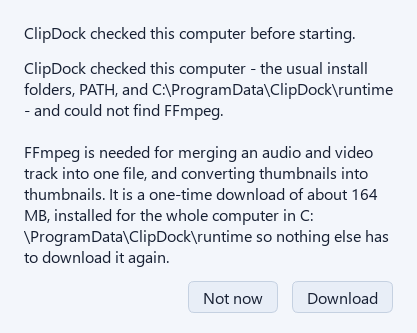

# ClipDock

[](https://github.com/Abdalllah10Ahmed/ClipDock/actions/workflows/ci.yml)

ClipDock is a Windows 10/11 desktop app for downloading publicly accessible media from popular sites (best-effort, powered by [yt-dlp](https://github.com/yt-dlp/yt-dlp)). It can save video (MP4), audio (MP3), thumbnails, and **author-provided/manual** captions (`.srt`/`.vtt`) when available. It also supports playlists/collections where supported and mixed-site batch queues.

When a site provides a clean/no-watermark variant, ClipDock prefers it automatically. If no clean variant is exposed, it downloads the available media without claiming watermark removal.

## Screenshots



<details>
<summary>More screenshots</summary>

**Playlist mode**


**Dark theme (Nord)**



**First-run FFmpeg prompt**



</details>

## Install (recommended)

1. Download **`ClipDock-Setup.exe`** from the [Releases](https://github.com/Abdalllah10Ahmed/ClipDock/releases) page.
2. Run the installer (per-user, no administrator rights required).

**Notes**
- The installer is not code-signed, so Windows SmartScreen may warn you. Click **More info → Run anyway** if you trust the source.
- On first run, ClipDock checks for FFmpeg on your system. If it is missing, it may offer a one-time download/install (FFmpeg is needed for merging, conversion, and some MP3 features). You can decline and still use features that do not require it.

## How to use

1. Paste a supported URL (or a playlist/collection URL in **Playlist** mode, or multiple links in **Batch queue**).
2. Click **Fetch details** (single/playlist modes).
3. Choose a mode: **Video (MP4)**, **Audio (MP3)**, **Thumbnail**, **Subtitles**, **Playlist**, or **Batch queue**.
4. Pick the available quality/format/bitrate/language options (options depend on the site and link).
5. Choose an output folder and click **Download**.

Availability varies by site/link and extractor support. Private, removed, age/region-restricted, DRM-protected, or otherwise unavailable items may fail; in playlists/batches, failures are reported per item where possible.

## Captions

- Only **author-provided/manual** captions are supported (auto-generated captions are not included).
- Caption availability, languages, and formats depend on the source.

## Requirements

- Windows 10/11 (x64)
- Internet access for supported sites
- Python 3.10–3.14 (only needed when running from source)

Runtime dependencies are PySide6 and yt-dlp (bundled in releases). FFmpeg is used for media processing and may be installed/downloaded when needed.

## Run from source

```powershell
git clone https://github.com/Abdalllah10Ahmed/ClipDock.git
cd ClipDock
.\scripts\setup.ps1
.\scripts\run.ps1
```

`setup.ps1` creates `.venv`, installs pinned Python packages, and fetches/verifies bundled binaries.

## Build

```powershell
# Windows executable (dist\ClipDock\)
.\scripts\build_exe.ps1

# Installer (dist\ClipDock-Setup.exe)
.\scripts\build_installer.ps1
```

See `scripts/` for additional build options and [CHANGELOG.md](dev/CHANGELOG.md) for release notes.

## Disclaimer

Only download content you own or are authorized to download. You are responsible for complying with applicable laws and the terms of the sites you use. ClipDock does not bypass private, age, region, DRM, or verification controls.

## License

- ClipDock source: see [LICENSE](LICENSE).
- Third-party components: see [THIRD_PARTY_NOTICES.md](dev/THIRD_PARTY_NOTICES.md).
